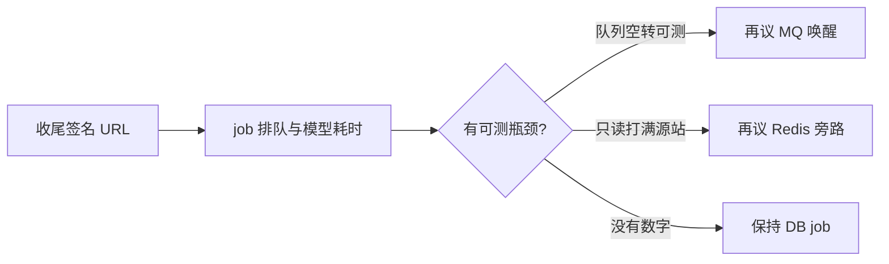

# 现在先做什么

记录日期：2026-11-01；修订：2026-11-01 完成立刻做 1–2。
状态：当前后端优先级约定，不是工期承诺，也不替代 [产品方向](产品方向.md) 或已采用 ADR。

## 结论

**先收尾学习室签名课件 URL，再给生成任务打「排队 vs 模型」计时。先不上 Redis、MQ、向量 RAG。**

容量分层约定：**MySQL 仍是 job 真相源**；以后若要加中间件，Redis 只缓存可共享只读投影，MQ 只发 `job_id` 唤醒并保留 poll。本文只定顺序。

## 立刻做（工作区已改）

### 1. 学习室签名 URL

学习室消费读模型上的 `parameters.imageUrl`（签名 `.webp` / `.png`），不再拼 `/api/v1/presentation/slides/{id}/image`。后端 `StudyroomService` 读时覆盖该字段。验收入口：`ppt-image.spec.ts`、`classroom-pages.spec.ts`、`StudyroomSlideScene.spec.ts`、`StudyroomPageDirectory.spec.ts`。未在真实浏览器走通前，不能写成已上线。

### 2. 生成链观测（容量阶段 1）

- 配置：`app.studyroom-generation.poll-interval-ms`、`capacity`（环境变量 `STUDYROOM_POLL_INTERVAL_MS`、`STUDYROOM_WORKER_CAPACITY`）。每用户 1 个 RUNNING 仍由 claim SQL 限制。
- 日志：`Studyroom job claimed ... queueWaitMs=`、`Studyroom job phase ... elapsedMs=`、`Studyroom job finished ... executionMs=`；模型调用仍有 `Studyroom model call ... elapsedMs=`。
- 测试：`GenerationJobTimingTest`、`GenerationPropertiesTest`。

没有「排队 P50 持续大于模型执行」或「只读把源站 CPU/DB 打满」的数据，不进入 Redis/MQ。

## 先不要做

| 项 | 原因 |
|----|------|
| Redis 当 job 状态 / 分布式锁真相 | job、租约、额度的权威在 MySQL |
| MQ 替换 worker | 最多砍掉约 1s poll；模型 RTT 与有意限流才是主耗时 |
| 应用缓存解决「打开网页慢」 | 动态请求受跨境 RTT 限制；课件应走边缘 HIT |
| 向量 RAG / PPT OCR 管线 | ADR-0010 仍为提议；短键防不了同章语义错配 |
| 再拆「选 PPT / 选动画」成独立模型调用 | 候选由 Resolver 构建，模型只勾短键 |

## 两条线不要混

| 目标 | 先做 | 文档 |
|------|------|------|
| 翻课件/打开慢、以后多实例 | 上文 1 → 2 | 本文 |
| 课上追问答得准 | 冻结真实代码版本、运行快照、动画帧 | [产品方向](产品方向.md) 第一阶段 |

后端容量工作不能冒充产品第一阶段已完成；追问现场也不能当成已经上了分布式队列。

## 阶段 2/3 的门禁（未到）

进入阶段 2/3 的条件：

- **MQ 仅唤醒**：多实例下 claim 空转可测，且 poll 补偿仍保留；载荷只有 `job_id`。
- **Redis 读旁路**：仅公开目录 / 知识快照等可共享只读投影；禁止缓存 job、lease、额度、用户课程列表。

测试 profile 不得依赖真实 Redis/MQ，也不得打付费模型。
